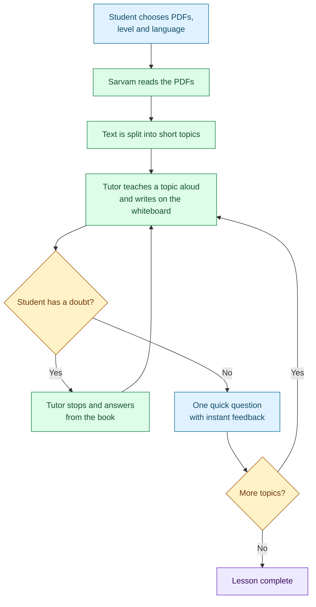
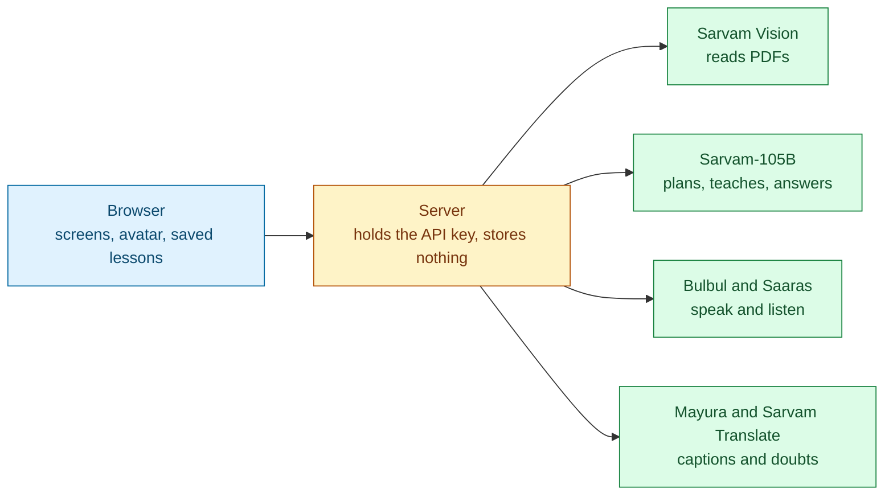

# Doubtless

Upload a textbook chapter and an animated tutor teaches it to you out loud, writing notes on a whiteboard as it talks. Interrupt at any moment with a doubt, spoken or typed. The tutor stops, answers from your book, then picks up from the sentence it was on.

## Who it is for

- **Students** who want a patient tutor for a short chapter, in their own language and at their own level.
- **Builders** looking for a working example of an AI product built on Sarvam's models for reading documents, speech, translation and chat.

## Run it

**Prerequisites:** Bun, Node.js and a Sarvam API key.

Get the code and install the packages:

```bash
git clone https://github.com/10doshi12/sarvam-ai-tutor.git
```

```bash
cd sarvam-ai-tutor
```

```bash
bun install
```

Create your settings file, then put your key in it as `SARVAM_API_KEY`:

```bash
cp .env.example .env
```

Start the app, then open http://localhost:3000:

```bash
bun run dev
```

### Run the tests

The browser tests drive WebKit and call the real Sarvam services, so they need your key and use some of your quota. Install the browser once:

```bash
bunx playwright install webkit
```

```bash
bun run test:e2e
```

### Deploy to Vercel

1. Import this repository as a new project on Vercel.
2. In the project settings, add the environment variable `SARVAM_API_KEY`.
3. Turn on Vercel Authentication for the deployment.

Step 3 matters because the app has no login of its own. Without it, anyone with the link could start lessons paid for with your key.

## How a lesson works



A student can click any topic to jump straight to it.

## Goals

- Turn one or several textbook PDFs into a single lesson of short topics.
- Teach each topic aloud beside a whiteboard, with an avatar that reacts to the moment: listening, thinking, asking, pleased or concerned.
- Let the student interrupt by voice or typing, get an answer, and carry on from the same sentence.
- Check understanding with one quick question per topic, and tick off finished topics.
- Teach in nine languages (English, Hindi, Bengali, Gujarati, Kannada, Marathi, Punjabi, Tamil, Telugu) at three levels (school, college, expert).
- Run on a laptop or on Vercel with no database.

## Non-goals

| Not doing | Why |
|---|---|
| Single PDFs over 10 pages | Sarvam's document reader has a per-job page limit. Split a longer book into several PDFs. |
| Very large PDF files | Uploads pass through the server because Sarvam's upload storage refuses direct browser uploads, and Vercel limits request size. The upload form enforces the limit and explains it. |
| A photorealistic avatar | The avatar is drawn and animated in the browser from the tutor's audio, so it needs no video service. |
| Lessons across devices or browsers | There is no database. Lessons stay in the browser that made them. |
| Keeping the original PDF | Often too big for browser storage, and nothing needs it once the text is read. |
| Hands-free interruption | The microphone would hear the tutor. A button works reliably, even on speakers. |
| Word-by-word board writing | The voice service gives no word timings, so the board follows each sentence. |
| Changing difficulty from quiz answers | Kept out to keep the first version small. |
| Malayalam and Odia lessons | The voice model has no voices for them yet. A doubt can still be asked in these languages. |
| Login or rate limiting | Not built. Use Vercel Authentication on any deployment. |
| Voice cloning and beta chat models | Both are in beta and add nothing to this flow. |

## Principles

- **The lesson never freezes.** If speech fails or sound is blocked, captions carry the lesson forward.
- **The student stays in charge.** They can interrupt, skip an explanation or switch topic at any time.
- **Stay on the book.** Answers come from the uploaded text first, and the tutor says so when the book does not cover a question.
- **The secret key stays on the server.** It never reaches the browser.
- **The textbook is material, not instructions.** Text inside a PDF is never treated as a command.

## How it fits together

The browser runs the lesson and keeps it in local storage. The server holds no data: it only passes requests to Sarvam using the secret key, which is what lets it run on Vercel.



## Modules in plain words

| Module | What it does |
|---|---|
| Upload and preparation | Checks the PDFs in the browser, has Sarvam read them, and joins them into one lesson. If there is too much text, each document gets a fair share. |
| Lesson writer | Plans the topics and writes what the tutor says and writes for each one, matched to the level and language. |
| Player | Runs the lesson: speech, topic switching, interruptions, quizzes and progress. |
| Avatar | Four shaded, lightly 3D tutors to choose from, each with their own look and voice, whose mouths follow the audio. It blinks, nods, gestures, follows the pointer and changes expression with the moment. |
| Whiteboard | Writes notes, equations and simple diagrams in time with each sentence. Answers to doubts appear on a separate overlay so the lesson notes survive. |
| Doubts | Hears or reads the question, translates it if it is in another language, and answers from the book. |
| Sarvam connection | The server's only outside link, and the only place that uses the secret key. |
| Browser storage | Saves lessons, extracted text and progress on the student's device. |

## How we know it works

| Scenario | Expected outcome | Why it matters |
|---|---|---|
| Upload a PDF, start, interrupt with a typed doubt | The tutor answers, then repeats the interrupted sentence | This is the core promise of the product |
| Reload during a lesson | The lesson and progress are still there | There is no database to fall back on |
| Upload several PDFs | One lesson is built from all of them | Students can combine chapters |
| One long PDF next to a short one | The short one still reaches the tutor | A long document must not silently hide another |
| Upload a PDF over 10 pages, or too many PDFs | Refused with a clear message before anything is sent | Saves waiting and quota |
| Speak a sentence, then transcribe it | The words come back | Proves the voice services work end to end |
| Answer a quiz when audio never finishes | The lesson still moves on | The lesson must never freeze |
| Click another topic | The tutor switches straight away | The student stays in charge |
| Switch tutor inside a lesson, then reload | The new tutor and voice are still there | The choice belongs to the lesson |

The automated tests cannot use a microphone, because WebKit under Playwright has no fake one. Check spoken doubts by hand after changing that path.

## Limits

- Lessons stay in one browser. Clearing the site's data deletes them.
- Spoken doubts must be short. Longer recordings stop automatically.
- Quality depends on the PDF. Poorly printed scans may be read badly.
- Whiteboard handwriting covers Latin and Devanagari. Other scripts use the system font.
- If one PDF cannot be read, the lesson fails with a message naming that file.
- Some languages have too few voices, so tutors share one, and the female tutors speak Tamil with an English voice.
