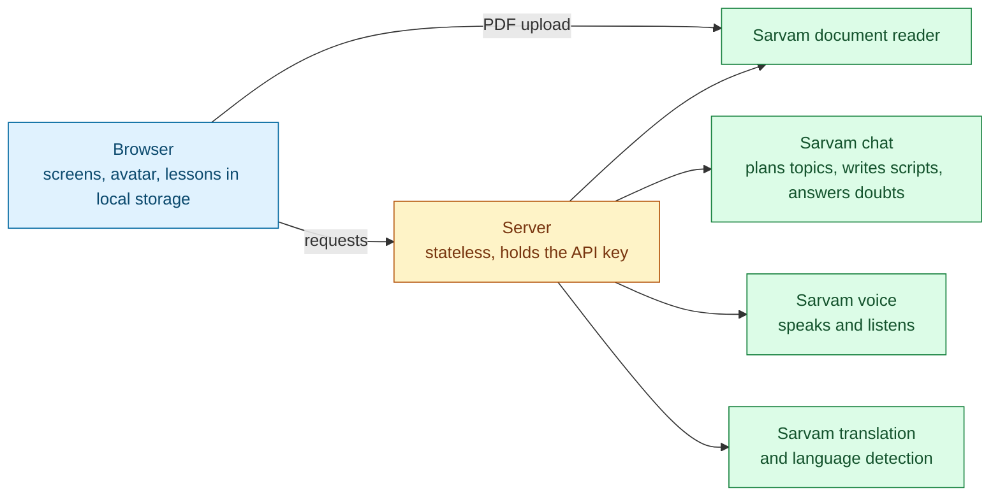

# AI Avatar Tutor

An illustrated avatar teaches you a textbook chapter out loud, writing notes on a whiteboard as it talks. You can interrupt at any moment with a doubt, spoken or typed. The avatar stops, answers from your book, then carries on from the sentence it was on.

## Who it is for

Students who want a patient tutor for a short chapter, in their own language and at their own level (school, college or expert). It is also a working example of an AI product built on Sarvam's models for reading documents, speech and chat.

## Run it

Prerequisites: bun and a Sarvam API key.

Install the packages:

```bash
bun install
```

Add your key. Copy the example settings file, then put the key in it as `SARVAM_API_KEY`:

```bash
cp .env.example .env
```

Start the app, then open http://localhost:3000:

```bash
bun run dev
```

Run the browser test. It uses WebKit and calls the real Sarvam services, so it needs the key, takes several minutes and uses a little of your quota. The first time, install the browser it drives:

```bash
bunx playwright install webkit
bun run test:e2e
```

The test cannot cover the microphone, because WebKit under Playwright has no fake one. Typed doubts and the speech services themselves are covered.

## Deploy to Vercel

1. Import the repository as a new project on Vercel.
2. In the project settings, add the environment variable `SARVAM_API_KEY`.
3. Turn on Vercel Authentication for the deployment.

Step 3 matters because the app has no login. Anyone who knows the URL could use it, and every lesson they start is paid for with your key.

## Goals

- Turn one or several textbook PDFs, each up to 10 pages, into one lesson of short topics, each taught aloud beside a whiteboard.
- Let the student interrupt by voice or typing, get an answer from the book, and pick up where the lesson stopped.
- End each topic with one quick question and instant feedback, and tick off finished topics.
- Teach in nine languages (Hindi, English, Bengali, Gujarati, Kannada, Marathi, Punjabi, Tamil, Telugu) at three levels.
- Run on a laptop and on Vercel with no database.

## Non-goals

| Not doing | Why |
|---|---|
| Single PDFs over 10 pages | The document reader has a per-job page limit. Split a longer book into several PDFs. |
| Keeping the original PDF | It is often too big for the browser's storage, and nothing needs it once the text is read. |
| Lessons across devices or browsers | There is no database. Lessons live in the browser that made them. |
| Hands-free interruption | The microphone would hear the avatar. A button works reliably, even with speakers. |
| Streaming speech | One request per sentence is simpler and keeps voice and board in step. |
| Word-by-word board sync | The voice service gives no word timings, so the board follows each sentence. |
| Adjusting difficulty from quiz answers | Kept small for now. |
| Malayalam and Odia lessons | The voice model has no voices for them. A doubt can still be asked in them. |
| Login or rate limiting | Not built. Use Vercel Authentication on any public deployment. |

## How it fits together

The browser does the preparation and keeps your lessons. The server only passes requests on to Sarvam and holds the secret key. Your PDF goes straight from the browser to Sarvam's document reader, so large files are not squeezed through the server.



## Limits

- Each PDF holds at most 10 pages, and a lesson takes a limited number of PDFs.
- When several PDFs are very long, each is trimmed fairly so the lesson stays within what the model can read at once.
- One person per browser. Clearing the site's data deletes the lessons.
- A spoken doubt must be short; longer recordings are cut off.
- Quality depends on the PDF: scanned pages with poor print may be read badly.
- Non-Latin handwriting on the whiteboard falls back to the system font for scripts other than Latin and Devanagari.
